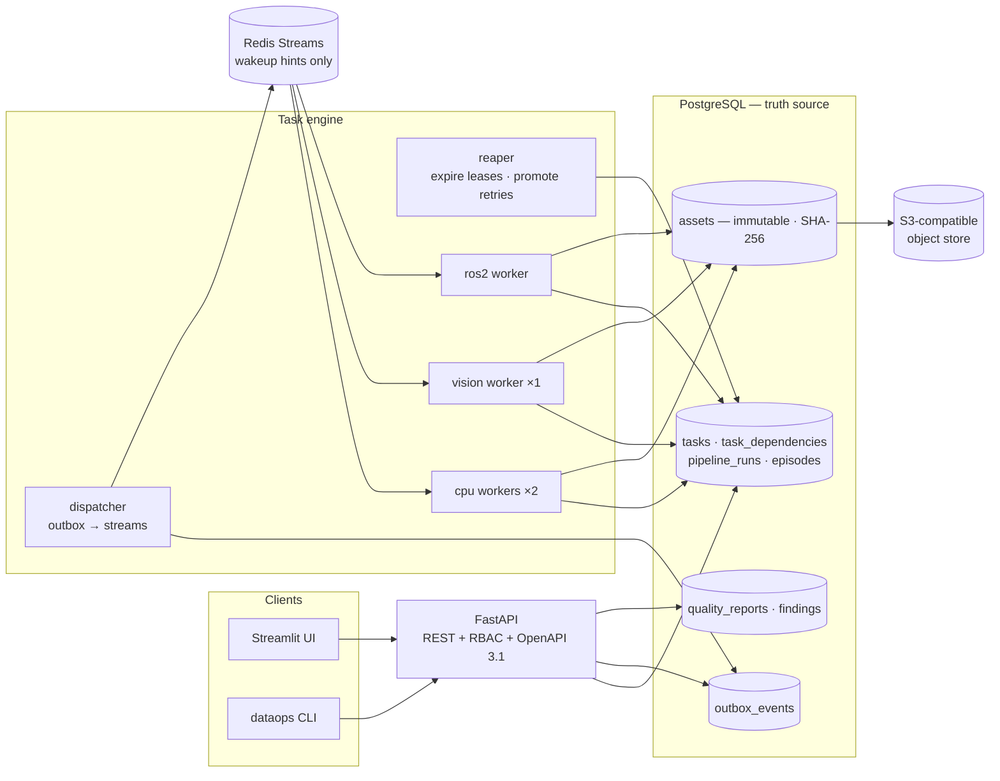
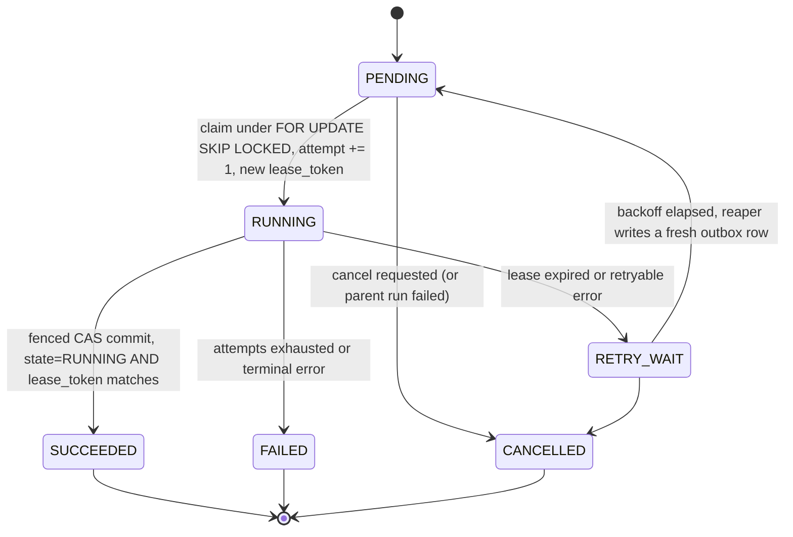

# Embodied DataOps

**具身智能多模态数据生产与质量闭环平台** — a single-host, Docker-Compose reproducible
platform for ingesting robot and ego-video Episodes, normalizing them into a versioned
canonical contract, running deterministic quality checks, AI pre-annotation and human
review, then freezing reviewed Episodes into immutable dataset versions that are
exported through the **official LeRobot v3 Writer** and re-opened with the official
Reader.

[](LICENSE)
[](pyproject.toml)
[](docs/api-openapi.json)
[](#tests-and-what-they-prove)

<!-- CI badge: enable after the repository exists and Actions has run once.
[](https://github.com/<owner>/embodied-dataops/actions/workflows/ci.yml)
-->

> This repository is an engineering prototype. It is **not** a production robot-control
> system, not a VLA training stack, and it does not claim million-Episode throughput.
> Synthetic fixtures are always labelled `data_origin=synthetic`; nothing synthetic is
> ever presented as real robot capture. See `docs/implementation-status.md` for the
> honest, AT-by-AT state of the delivery.

## What exists

| Area | Implementation |
|---|---|
| Ingest | LeRobot v3 `.tar.gz` (official API), Ego MP4 (ffmpeg), restricted ROS 2 MCAP profile (separate Jazzy worker) |
| Canonical contract | `canonical-episode/1.0`: 10 Hz, 640×480 single `front` camera, 6-D `state`/`action`, Parquet samples + H.264 MP4 |
| Task reliability | PostgreSQL state machine + transactional Outbox + Redis Streams wakeups + 60 s lease / 15 s heartbeat / fencing token / 3 attempts / reaper |
| Quality | `qc-policy/1.0` rules with machine-readable findings and explicit sync metrics |
| Annotation | YOLO11n CPU pre-annotation, immutable annotation sets, reviewer approve/reject |
| Delivery | `dataset-manifest/1.0`, immutable versions, official LeRobot v3 export + separate-process round-trip verification |
| Feedback | deterministic evaluation/gap analysis producing collection orders (simulated evaluation clearly flagged) |
| UI | Streamlit (API-only, four pages); host-run via `make ui`, container image built on Linux/CI (ADR-0010) |
| Ops | Prometheus metrics, structured JSON logs, Alembic migrations, failure-injection scripts |

## Architecture

One host, one PostgreSQL, one Redis. **PostgreSQL is the only task truth source**; Redis
carries wakeup hints that may be lost or duplicated without changing the outcome.



### Task lifecycle



### The commit path that makes duplicate delivery harmless

```mermaid
sequenceDiagram
    autonumber
    participant W as Worker
    participant P as PostgreSQL
    participant R as Redis Stream
    participant S as Object store

    R->>W: XREADGROUP wakeup {task_id}
    W->>P: SELECT ... FOR UPDATE SKIP LOCKED
    P-->>W: lease_token + lease_until = now + 60 s
    W->>R: XACK (hint consumed, lease is the authority)
    W->>S: write staging/{task_id}/{lease_token}/...
    loop every 15 s
        W->>P: UPDATE tasks SET lease_until = now + 60 s<br/>WHERE state = 'RUNNING' AND lease_token = :token
        P-->>W: 1 row = still mine, 0 rows = lost it, stop
    end
    W->>P: UPDATE ... SET state='SUCCEEDED' WHERE state='RUNNING' AND lease_token=:token
    alt rowcount = 1
        P-->>W: committed; next-step task + outbox row in the same transaction
    else rowcount = 0
        P-->>W: stale token — roll back this attempt entirely
    end
    Note over P: reaper every 10 s moves expired leases to RETRY_WAIT
```

Three properties follow from this and are proven by tests rather than asserted:
duplicated wakeups produce one execution, a `kill -9` worker leaves no permanently
`RUNNING` task, and a stale worker cannot overwrite a newer result.

## V2 / V2.1 incremental upgrade

The V2 series adds a robot **Profile Registry** (6D/7D), **native multi-stream time
indices** plus aligned/preview views, **robot semantic QC**, **annotation revisions**,
**conditional writes / operation receipts**, diagnostic read APIs, scenario coverage and
collection-order fulfilment, and bounded **PointCloud2** parsing — while keeping every V1
read path and published asset frozen.

- design rationale and invariants: [`docs/design.md`](docs/design.md)
- binding decisions: [`docs/ADR/`](docs/ADR/) (start with ADR-0001 and ADR-0007)
- V2 grid, both online and synthetic, covers `make fixture-v2`, `make test-v1-compat`,
  `make test-v2`, `make bench-v2`

Not every acceptance item is closed. Items that need hardware or credentials that are not
available in a given environment are reported as `BLOCKED`/`NOT_RUN`, never as `PASS` —
see [`docs/implementation-status.md`](docs/implementation-status.md).

## Quick start (single host, Linux + Docker)

```bash
make bootstrap     # .env, venv, dependencies
make up            # postgres, redis, object store, migrate, api, dispatcher, workers
make migrate       # alembic upgrade head (idempotent)
make seed          # generate the ten synthetic fixtures and import them
make test          # unit + integration + contract tests
make ui            # Streamlit UI on the host (container UI image is built on Linux/CI)
``` 

**Windows development host (ADR-0011)**: project container images are **not built on
Windows**; the local stack runs as host processes against already-pulled dependency
containers:

```powershell
scripts/dev_stack.ps1 -Force     # db/redis/Silo containers + migrate + api + dispatcher + workers
make ui                          # host Streamlit UI
scripts/stop_dev_stack.ps1       # stop host processes (containers stay up)
```

The final container build/GPU/ROS/UI-image verification runs on the Linux + cloud-GPU
demo environment; the one-shot checklist is
[`docs/linux-demo-plan.md`](docs/linux-demo-plan.md).
```

The API is at <http://localhost:8000>, OpenAPI at `/openapi.json` and `/docs`.
Initial API keys are printed **once** by `make bootstrap` (`scripts/bootstrap.sh`);
only their SHA-256 digests are stored in PostgreSQL.

## Tests and what they prove

Markers describe **dependencies**, not scope — `-m integration` mixes ordinary flows with
atomicity checks, so it is not a safety signal on its own.

| Gate | Command | What a green run means |
|---|---|---|
| Unit | `uv run pytest -m unit` | pure in-process logic: alignment operators, QC rules and boundaries, state machines, schema validation |
| **Concurrency** (release gate) | `make test-concurrency` | two real workers competing on real row locks and unique keys: one lease winner, one committed product, no double budget |
| Failure injection | `uv run pytest tests/failure -q` | duplicate wakeups, `kill -9` recovery inside the lease window, Redis outage, stale-token late commit |
| Contract | `uv run pytest -m contract` | the export is re-opened by the **official** LeRobot v3 Reader in a separate process |
| Performance | `make benchmark` | P95 budgets measured and stored in a report; a missed budget fails and is reported as unmet |
| ROS 2 / real weights | `-m ros2`, `-m vision` | require a Jazzy worker image or downloaded YOLO weights; recorded as `BLOCKED`/`NOT_RUN` when unavailable, never as passed |

Failures of the honest kind are expected output: `docs/implementation-status.md` keeps every
`PARTIAL`/`BLOCKED`/`NOT_RUN` item visible, and `docs/evidence/` ships the measured numbers
with the machine and command that produced them.

## Demo

The Streamlit UI is API-only (no direct database access) and has four pages:

1. **Import** — upload a LeRobot `.tar.gz` or an Ego MP4 and watch ingest.
2. **Pipeline board** — per-step task state, lease owner, retries and cancel.
3. **Quality review** — findings with evidence, approve/reject with the WARN release note.
4. **Datasets & feedback** — frozen versions, export status, collection orders.

```bash
make bootstrap && make up && make seed   # synthetic fixtures land in READY_FOR_REVIEW
make ui                                  # http://localhost:8501
```

<!-- Screenshot hook: once a demo host is available, drop four PNGs under docs/images/
     (import.png, pipeline.png, review.png, datasets.png) and reference them here. Images
     are not committed while empty, so the README never shows a broken link. -->

## Repository layout

```text
src/embodied_dataops/
  api/          FastAPI routes, schemas, auth, error envelope
  db/           SQLAlchemy models, sessions
  domain/       enums, state machines
  imports/      ego_mp4, lerobot_v3, mcap_profile_v1
  canonical/    contract, timebase, alignment, video
  workflow/     DAG, outbox, leases, dispatcher, worker, reaper, handlers
  quality/      qc-policy/1.0 rules and reports
  processing/   ffmpeg, detection, preview
  datasets/     manifest, official LeRobot writer/reader, version service
  feedback/     evaluation import, gap analysis, collection orders
  observability/ metrics and audit
  cli/          seed, benchmark, acceptance, maintenance
src/embodied_ui/  Streamlit pages (HTTP API only)
services/ros2_adapter/  ROS 2 Jazzy MCAP bridge (independent container)
alembic/           database migrations
fixtures/          deterministic synthetic fixture generators
tests/             unit / integration / e2e / failure / contract / performance
docs/              architecture, data contract, ADRs, test report, runbook
```

## Documentation

- [`docs/design.md`](docs/design.md) — what the platform guarantees, what it refuses to do, and why
- [`docs/architecture.md`](docs/architecture.md) — components, state machine, failure model
- [`docs/data-contract.md`](docs/data-contract.md) — canonical contract, quality policy, dataset manifest
- [`docs/ADR/`](docs/ADR/) — binding decisions and documented deviations
- [`docs/implementation-status.md`](docs/implementation-status.md) — DONE / PARTIAL / BLOCKED per milestone
- [`docs/benchmark.md`](docs/benchmark.md) + [`docs/evidence/`](docs/evidence/) — how to reproduce the measurements, and the measured values
- [`docs/ops-runbook.md`](docs/ops-runbook.md) — recovery operations
- [`docs/licenses.md`](docs/licenses.md) — third-party licences and data provenance

## Licence

Project code: **AGPL-3.0-only** (see `LICENSE`). The network-copyleft obligation is accepted
deliberately: the quality policy, the lease/CAS task protocol and the canonical contract are
the interesting parts of this repository and they stay open, including when offered as a
network service.

Third-party dependencies keep their own licences; see [`NOTICE`](NOTICE) and
[`docs/licenses.md`](docs/licenses.md). In particular Ultralytics YOLO (`vision` extra) is
AGPL-3.0, and the shipped weights are **not** redistributed — `scripts/run_yolo_real.py`
downloads them and records the SHA-256 it observed.
